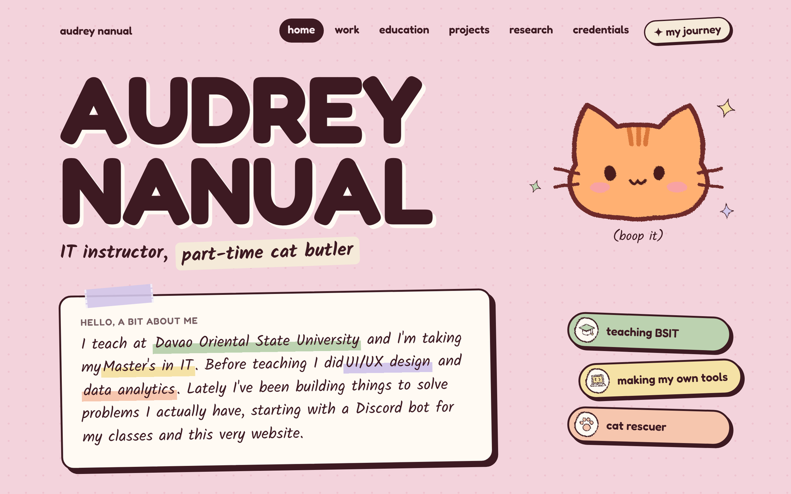
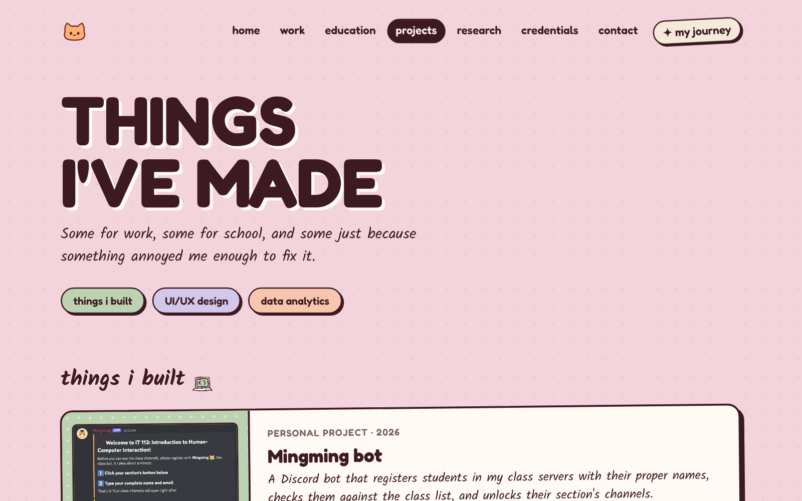
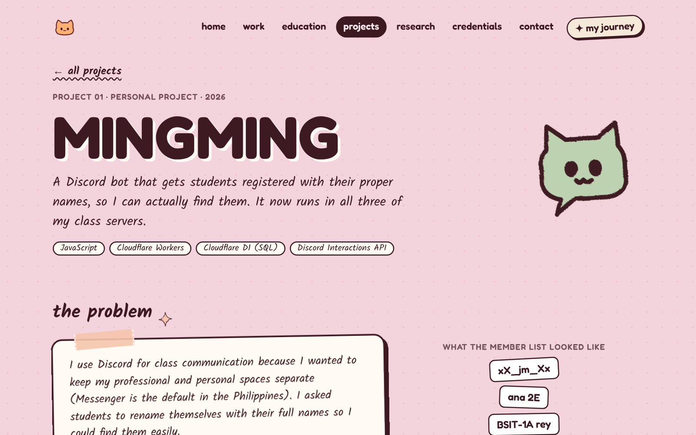
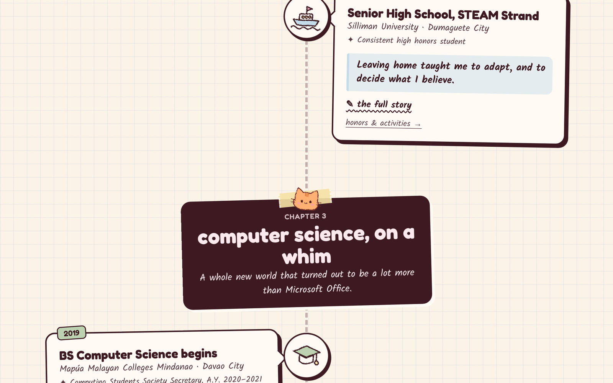

# audrey nanual ✦ personal website

My little corner of the internet: a portfolio on the front, a cozy back room for cats and hobbies on the side.
Pink, scrapbooky, and full of cats.

**Live site:** https://audrey-nanual.audreycj.workers.dev



## What's inside

| Page | What it is |
|---|---|
| **Home** | Who I am, at a glance |
| **Work** | Teaching at DOrSU, UI/UX design, a software dev internship, and my first campus job |
| **Education** | From Immaculate Heart of Mary Academy to my Master's in IT at Mapúa |
| **Projects** | Mingming (a Discord bot for my class servers), my lessons website for students, my MIT study notebook, UI/UX case studies from Telemondo, and data analytics work |
| **Research** | My undergraduate thesis, plus a plain-language explainer of it |
| **Credentials** | Awards, certificates, and the languages in my life |
| **Contact** | A message form that lands in my inbox, plus LinkedIn and GitHub |
| **My Journey** | The whole story as a scrollable path, with a little cat that walks it with you |
| **The cozy side** | The not-work part: blog, cats, cat rescue, art (rooms still being furnished) |

<table>
  <tr>
    <td></td>
    <td></td>
  </tr>
</table>



## Little details

- **Hand-drawn wobble:** outlines gently "boil" like a cartoon, using SVG noise filters swapped about 8 times a second.
- **Cats everywhere:** the chibi cats are drawn in SVG, blink on their own, and follow your cursor with their eyes. Boop the big one.
- **Scrapbook styling:** washi tape, sticker shadows, marker highlights, and folded-corner certificate cards.
- **Zoomable screenshots:** project images open full-size in a little lightbox.
- **Respects your settings:** if your device asks for reduced motion, the animations turn off (the home strip just drifts slowly, and you can tap it to pause).
- **Easy to find:** a sitemap, link previews for Messenger, LinkedIn, and Discord, and search-engine data that ties my name to my profiles.
- **Fast and simple:** a static site with no framework running in the browser, just HTML, CSS, and a bit of JavaScript.

## Built with

[Astro](https://astro.build) · TypeScript · CSS · SVG · deployed on [Cloudflare Workers](https://workers.cloudflare.com)

Built by Audrey Nanual, with help from [Claude](https://claude.ai) (Anthropic) for code and documentation.

Fonts: [Fredoka](https://fonts.google.com/specimen/Fredoka) and [Kalam](https://fonts.google.com/specimen/Kalam).
School, company, and certificate logos belong to their respective organizations and are used only to identify them.

---

## Working on the site

### Run it locally

You need Node.js 22.13 or newer.

```bash
npm install      # first time only: downloads Astro into node_modules/
npm run dev      # starts a local preview at http://localhost:4321
```

Leave `npm run dev` running while you edit. The page in your browser updates every time you save a file.
Press `Control + C` in the terminal to stop it.

### Publishing

Pushing to `main` on GitHub is all it takes. Cloudflare rebuilds and redeploys the site on its own (`npx astro build`, then `npx wrangler deploy`).

```bash
git add .
git commit -m "type: what changed"
git push
```

Commit types I use: `feat` (new page or feature), `fix` (something broken), `style` (looks only), `content` (text, photos, data), `docs` (README), `chore` (setup).

### Where things live

```
personal-website/
├── src/
│   ├── data/          ← THE CONTENT. Start here.
│   │   ├── site.ts         name, web address, links, contact form key, nav, the scrolling band
│   │   ├── resume.ts       work experience + education (also feeds the journey)
│   │   ├── journey.ts      chapters + stops on the journey page
│   │   ├── projects.ts     project cards, case studies, practice projects
│   │   ├── tools.ts        the "my toolbox" section on the home page
│   │   ├── research.ts     research papers
│   │   ├── credentials.ts  certificates, awards, languages
│   │   └── logos.ts        which logo file belongs to which organization
│   ├── pages/         ← one file = one page (the file path is the URL)
│   │   ├── index.astro         /            home
│   │   ├── work.astro          /work
│   │   ├── education.astro     /education
│   │   ├── projects/index.astro      /projects
│   │   ├── projects/mingming.astro   /projects/mingming
│   │   ├── projects/[slug].astro     /projects/blasttext, … (one page per case study)
│   │   ├── research.astro      /research
│   │   ├── research/bacteria-colony-counting.astro   the thesis, explained simply
│   │   ├── credentials.astro   /credentials
│   │   ├── journey.astro       /journey
│   │   ├── contact.astro       /contact
│   │   ├── cozy.astro          /cozy        the back room
│   │   ├── 404.astro           page-not-found
│   │   └── sitemap.xml.ts      the list of pages for search engines (builds itself)
│   ├── components/    ← reusable pieces
│   │   ├── Cat.astro       the chibi cats (add new coats here)
│   │   ├── Doodle.astro    all the little drawings (trophy, boat, laptop…)
│   │   ├── LogoBadge.astro round logo badges (work, education, awards)
│   │   ├── Logos.astro     small logo tags (certificates)
│   │   ├── Shot.astro      screenshot frames (browser window, phone, plain)
│   │   └── Lightbox.astro  click a screenshot to see it bigger
│   ├── layouts/
│   │   └── Base.astro      wraps every page: nav, footer, shared animations
│   └── styles/
│       └── global.css      colors, fonts, reusable styles (.sticker, .tape, .chip…)
├── public/            ← files served as-is: favicon, logos, project images,
│                         og.png (the link-preview card), robots.txt
├── docs/screenshots/  ← images for this README
├── private/           ← stays on my laptop only (see .gitignore): certificates,
│                         original images, thesis files, content draft
└── wrangler.jsonc     ← Cloudflare settings
```

### Easy edits

- **Add a footer/contact link:** `links` in `src/data/site.ts`.
- **Got your own domain?** Update `url` in `src/data/site.ts` and the address in `public/robots.txt`.
- **Add a tool:** `src/data/tools.ts`.
- **Add a case study:** copy one entry in `caseStudies` in `src/data/projects.ts` and put its images in `public/projects/<slug>/`. Its page, its card, and its sitemap entry appear automatically.
- **Update a job or school:** edit it once in `src/data/resume.ts`. The Work, Education, and Journey pages all update.
- **Add a journey stop:** copy one `{ ... }` block in `src/data/journey.ts` and change the text.
- **Reorder the tabs:** change the order in `nav` in `src/data/site.ts`. The "next up" links follow the same order.
- **Change a color:** the variables at the top of `src/styles/global.css`.
- **Add a cat:** add a line to `COATS` in `src/components/Cat.astro`, e.g. `mochi: { fur: '#e8d9c4' }`, then use `<Cat coat="mochi" />`.

### Concepts you'll see

- **`.astro` files** have two parts. The top, between `---` lines, is JavaScript that runs when the site is built
  (importing data, looping over lists). Below it is HTML, with `{curly braces}` to drop in values.
- **Components** are like functions for HTML: `<Doodle name="trophy" />` reuses one drawing everywhere.
- **Scoped styles:** a `<style>` inside a page only affects that page.
- **Data files:** keeping content in `src/data/` means the site can be updated without touching the design.
